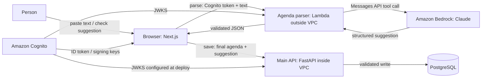

# Peach container diagram (C4 level 2)

The parser has no database access. Its public function URL validates Cognito
before calling the paid model. The existing API enforces meeting ownership and
stores both the suggestion and the checked result.
