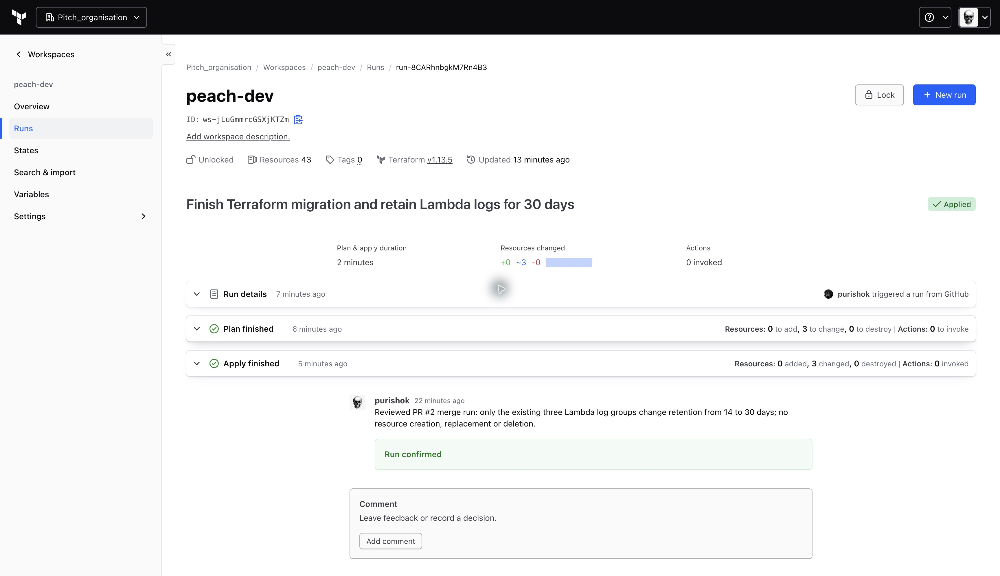

# Lab 7 submission — Peach

Completed on 29 October 2026.

1. Code: [migration PR #1](https://github.com/purishok/Peach/pull/1) and
   [final migration / VCS proof PR #2](https://github.com/purishok/Peach/pull/2),
   both merged into main. [Final code commit](https://github.com/purishok/Peach/commit/d3021ba75302ba4c15f2b971a1c134dd570a4ff3).
2. [HCP apply screenshot](media/lab7-hcp-apply.png):
   [GitHub-triggered run](https://app.terraform.io/app/Pitch_organisation/workspaces/peach-dev/runs/run-8CARhnbgkM7Rn4B3)
   after merging PR #2. Only three existing log groups changed retention, 14 to
   30 days. [Raw apply output](lab7-vcs-apply.txt).
3. [Immediate post-migration terraform plan](lab7-plan-after-migration.txt),
   ending in `No changes. Your infrastructure matches the configuration.`
   [Final plan after the drift exercise](lab7-plan.txt) has the same result.

40 managed resources were imported; none were re-created. HCP's displayed total
of 43 also includes three data sources. All three CloudFormation stacks released
their resources with Retain policies before adoption. The Cognito pool, its four
users, reports bucket and its four reports retained their identities and contents.

Workspace `Pitch_organisation/peach-dev` uses Remote execution, GitHub
`purishok/Peach`, branch `main`, directory `infra`, and phase-scoped OIDC roles in
both AWS accounts. No AWS access keys were copied into HCP. Sensitive variables
and state stay in HCP, outside the repository.

The drift exercise detected a manual parser timeout change (30 to 31 seconds),
then HCP restored 30 seconds. See the [migration record](lab7-migration.md) for
run IDs and verification, and [ADR 0007](adr/0007-terraform.md) for the decision,
alternatives, secret/state storage and HCP outage procedure.
