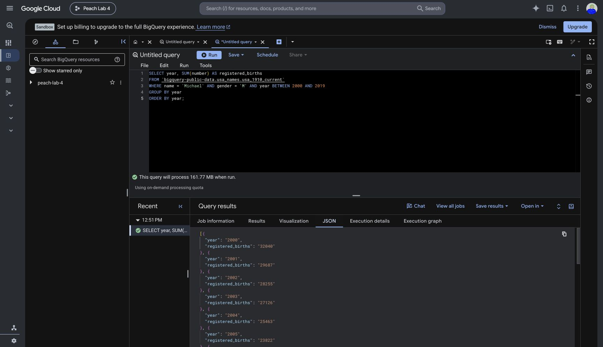
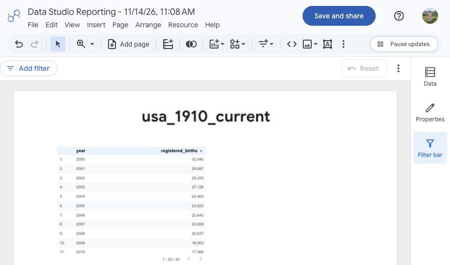
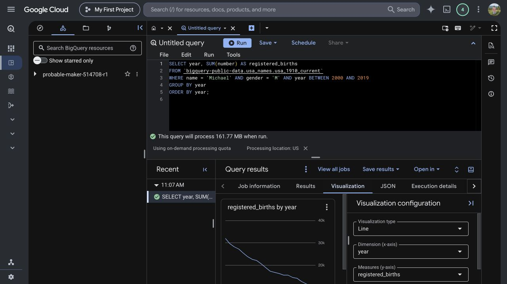
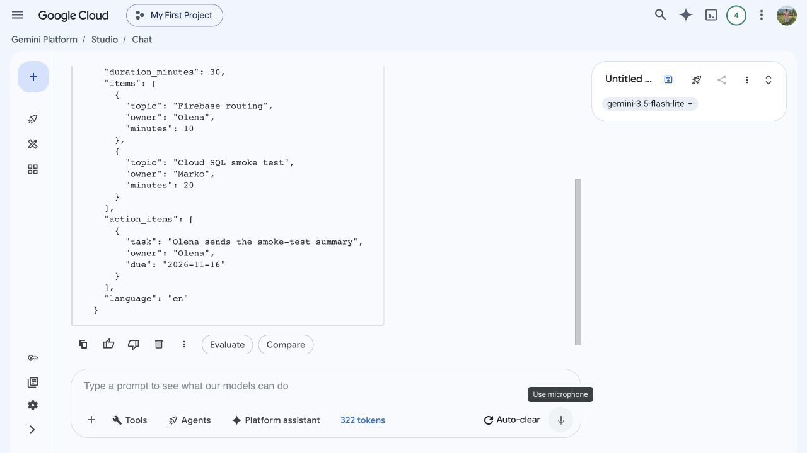
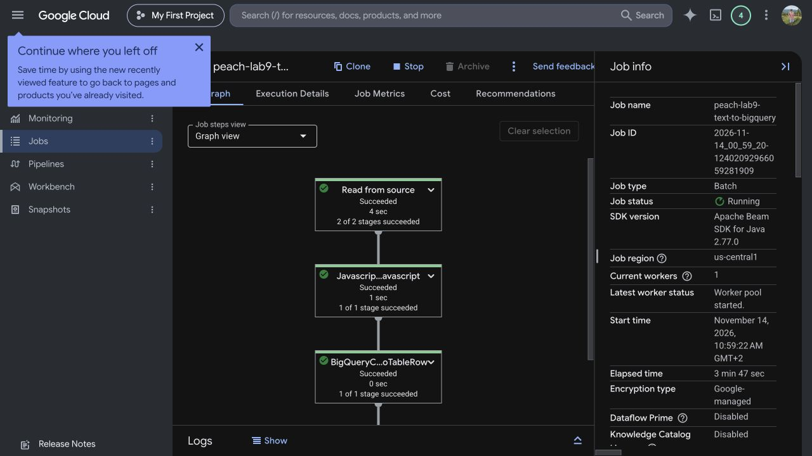
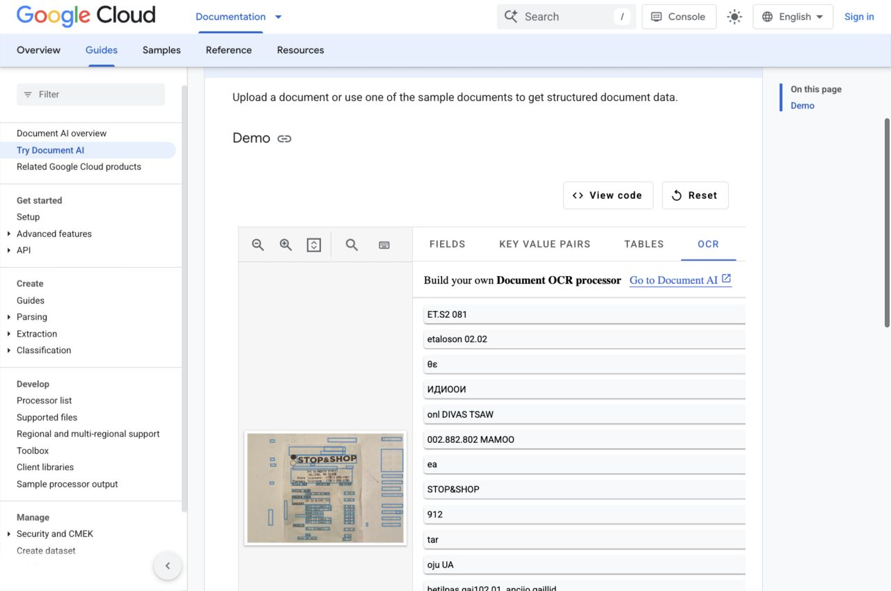

# Lab 9 — submission evidence

- [Architecture decision](../adr/0009-google-cloud.md)
- [Terraform deployment and cleanup](../../gcp/README.md)
- [Costs for four traffic profiles](costs.md)

## Live deployment

- [Peach on Firebase Hosting](https://probable-maker-514708-r1.web.app/)
- [Cloud Run health through Firebase Hosting](https://probable-maker-514708-r1.web.app/api/health)

Verified on 14 November 2026 that the frontend returns HTTP 200. An
authenticated request through Firebase Hosting to `GET /api/v1/health/ready`
returned HTTP 200 with `{"status":"ok","database":"ok"}` after executing
`SELECT 1` on Cloud SQL. The same route returns HTTP 401 without a token.

The browser check also passed in a Chrome Incognito window. After Cognito
sign-in, the Home dashboard displayed the workspace's empty task list rather
than a loading state. Cloud Run logged HTTP 200 for the authenticated
`GET /api/v1/items` requests made during the check.

The project has a $5 budget with alerts at 50%, 90%, and 100%. The budget does
not cap spending. Keep Cloud SQL running while the live URL is needed for
grading, then follow the [cleanup instructions](../../gcp/README.md#stop-or-clean-up).

## BigQuery

Ran [the query](usa-names.sql) over BigQuery's public USA Names dataset in the
existing sandbox on 13 November 2026. The query summed registered male births
named Michael by year. It returned 20 rows and processed 161.77 MB. BigQuery
reported 162 MB as bytes billed, within the sandbox quota. No permanent dataset
or result table was created. The [CSV](usa-names.csv) contains all 20 results.

## Looker Studio

Opened the BigQuery results in Looker Studio. Its table chart displayed all
20 rows. A line chart was configured with `year` on the horizontal axis,
`registered_births` on the vertical axis, and ascending year order. The
line did not render in the browser, so the line chart is shown separately
using BigQuery's Visualization tab.

## Gemini in Vertex AI Studio

Ran an adaptation of Peach's Lab 6 agenda prompt in Agent Studio, the console
that opened from Vertex AI Studio. Gemini 3.5 Flash-Lite parsed a synthetic
30-minute meeting into two agenda items and an action with an owner and due
date. It left `starts_at` as `null` because the input only said “after lunch.”

## Dataflow batch demo

Ran Google's Cloud Storage Text to BigQuery template with one worker. The
input was the 20 public rows from the BigQuery demo, with the CSV header
removed. A JavaScript function converted each line to a JSON object with
integer `year` and `registered_births` fields. The job succeeded, and a
BigQuery query verified that all 20 output rows matched the original CSV
exactly, covering 2000–2019 and totaling 395,535 registered births.

## Document AI OCR

Processed Google's **Expense** sample in the [public Document AI demo](https://docs.cloud.google.com/document-ai/docs/try-docai).
The OCR tab showed detected text such as `STOP&SHOP` alongside the bounding
boxes on the receipt. The Fields tab extracted line items and amounts,
including `JSPH ORG HUMMUS` at `5.99`.

### Cloud Vision OCR

Ran Cloud Vision API's `TEXT_DETECTION` on the
[Peach Cafe demo receipt](ocr-demo-receipt.png). The API recognized both line
items and the $9.00 total. [Full OCR output](vision-ocr.txt).

Document OCR is appropriate when the job is to transcribe a receipt or extract
its layout and field coordinates. An LLM is useful when a note implies
actions, owners or deadlines that must be interpreted in context. For a
photographed agenda, OCR can transcribe it before the LLM structures it.

In Lab 8, S3 holds payment data and Glue and Athena make it queryable.
On GCP, Cloud Storage holds the input, Dataflow can parse files and write
normalized rows, and BigQuery combines the SQL query engine and managed tables.
Looker Studio supplies the visualization. A BigQuery native table removes the
need to maintain a separate crawler and external-table metadata for those rows.
