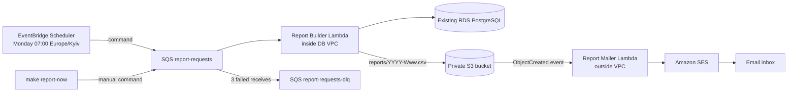

# Peach weekly reports lab

## Status and discovered environment

Implementation, local validation, deployment, and live AWS workflow validation
were completed on 2026-10-14. The `peach-reports` stack is `UPDATE_COMPLETE` in
AWS account `505464394565`, region `eu-north-1`. Amazon SES accepted both the
manual and scheduled test messages. The only submission artifact that cannot be
captured from AWS APIs is the screenshot of the delivered Gmail message with its
CSV attachment; the repository owner must add that screenshot before submission.

Repository and account inspection on 2026-10-14 found:

- Git remote: `https://github.com/purishok/Peach.git`.
- AWS account: `505464394565`; application region: `eu-north-1`.
- Production compute: ECS service `peach-backend-service`, task family
  `peach-backend-task`, ECR repository `peach-backend`.
- Production database: private RDS PostgreSQL 17 instance `peach-db` in
  `vpc-0ab26f4af42181d93`, not Aurora Serverless v2.
- Secret: `peach/rds/credentials`, with a `database_url` JSON field.
- The repository has a Lambda/Aurora template in `infra/backend.yaml`, but that
  stack is not deployed. Creating it would create a parallel empty database and
  would not report production meetings, so the report builder reuses the actual
  RDS database.
- The deployed report resources include builder and mailer Lambda functions, a
  private S3 reports bucket, an S3 gateway endpoint, SQS/DLQ, and an enabled
  EventBridge Scheduler schedule. SES remains in sandbox
  (`ProductionAccessEnabled=false`), so the same verified mailbox is used as
  sender and recipient.
- The active schema had `users` and `items`; `PROJECT.md` described meetings as
  a proposal, not an implemented table. Migration `0005` adds the report source
  table without changing existing tables or API behavior.

## Architecture



The schedule/manual payload is a **command**: it asks one worker to build a
report. The S3 ObjectCreated notification is an **event**: it announces a result
that already exists. Scheduler and `make report-now` are producers, SQS is the
buffer, the builder is the worker, S3 is the result store, and the mailer is the
subscriber.

SQS absorbs bursts, retries transient failures, and separates scheduling from
database/report work. Delivery is at least once, so duplicate processing is
expected. The deterministic key `reports/YYYY-Www.csv` makes report generation
idempotent at the object-key level: a repeat overwrites the same current object
(S3 versioning retains old versions for recovery). The 360-second visibility
timeout is six times the 60-second builder timeout. After three receives a poison
message is moved to the DLQ and can be inspected/redriven.

The builder remains in the VPC because PostgreSQL is private. An S3 gateway
endpoint, which has no hourly or processing charge, lets it upload without a NAT
gateway. The mailer has no VPC configuration, so it can call S3 and SES through
their public AWS endpoints without NAT or paid interface endpoints. S3 decouples
database/report generation from email delivery and provides an auditable report
artifact. Redis, RabbitMQ, Celery, and RQ could implement worker queues, but they
would add always-on infrastructure and operations that managed SQS/Lambda do not
need for a weekly job; none are deployed.

## Implementation

- `backend/app/reports/weekly.py` validates ISO weeks, handles ISO-year
  boundaries in `Europe/Kyiv`, queries current and preceding weeks, and renders
  deterministic UTF-8 CSV with counts, duration comparisons, five longest
  meetings, participant counts, and organizer totals when an organizer exists.
- `backend/app/reports/lambda_handler.py` accepts direct and SQS events, derives
  the previous Kyiv ISO week only when `week` is null, logs structured fields,
  and uploads to a deterministic S3 key. Exceptions propagate to SQS retries.
- `backend/app/reports/mailer.py` downloads an S3 report, constructs MIME with
  `EmailMessage`, and uses SES v2 `SendEmail` with raw content. It has no write
  permission to S3.
- `backend/app/models/meeting.py` and migration `0005` add the meetings source
  with database constraints and optional organizer ownership.
- `infra/reports.yml` defines the private/versioned/lifecycle-managed report
  bucket, S3 gateway endpoint, encrypted queue/DLQ, timezone-aware Scheduler,
  VPC builder, non-VPC mailer, event source mapping, S3 notification, log groups,
  optional SES domain identity, and scoped IAM roles.
- `scripts/deploy-reports.sh` discovers RDS/VPC/subnets/route tables/security
  group/secret, builds the existing backend Dockerfile's `lambda` target, deploys
  CloudFormation, and applies migrations through the builder image.
- `scripts/report-now.sh` validates `WEEK`, discovers the queue URL from stack
  outputs, sends JSON, and prints the real SQS MessageId.

## Configuration and deployment

The deployment used these values in the gitignored `.env` (the file is not
committed):

```dotenv
AWS_REGION=eu-north-1
PROJECT_NAME=peach
REPORTS_STACK_NAME=peach-reports
REPORT_SENDER_EMAIL=westagroinvest3@gmail.com
REPORT_RECIPIENT_EMAILS=westagroinvest3@gmail.com
SES_IDENTITY_NAME=westagroinvest3@gmail.com
CREATE_SES_EMAIL_IDENTITY=false
DB_INSTANCE_IDENTIFIER=peach-db
REPORTS_LAMBDA_ARCHITECTURE=arm64
```

The existing verified SES email identity was reused; CloudFormation did not
create a duplicate identity.

Deploy and inspect outputs:

```bash
make reports-deploy
aws cloudformation describe-stacks \
  --region eu-north-1 \
  --stack-name peach-reports \
  --query 'Stacks[0].Outputs' \
  --output table
```

When `CREATE_SES_EMAIL_IDENTITY=true`, the outputs `SesDkimName1..3` and
`SesDkimValue1..3` are the exact CNAME names/values to add in DNS. Do not claim
verification until this returns `SUCCESS` and `true`:

```bash
aws sesv2 get-email-identity \
  --region eu-north-1 \
  --email-identity "$SES_IDENTITY_NAME" \
  --query '{VerificationStatus:VerificationStatus,VerifiedForSendingStatus:VerifiedForSendingStatus,Dkim:DkimAttributes.Status}'
```

Because the account is in the SES sandbox, every non-mailbox-simulator recipient
must also be verified. Production access is optional for the lab if sender and
recipient are both verified.

Manual report commands:

```bash
make report-now WEEK=2026-W40
make report-now                 # previous ISO week in Europe/Kyiv
make reports-list
make reports-logs
make reports-test
```

## Validation evidence

Completed locally:

- `uv run ruff check .`: passed.
- Full backend `pytest` against the Compose PostgreSQL database: **43 passed**.
- Full Alembic chain through `0005` applied to a temporary PostgreSQL database;
  the meetings columns, indexes, foreign key, and three check constraints were
  inspected, then the temporary database was removed.
- Report coverage includes parsing, invalid weeks, ISO-year transitions, empty
  weeks, counts, durations, prior-week differences, top five, UTF-8,
  deterministic bytes, handlers, and PostgreSQL integration.
- `aws cloudformation validate-template`: passed for `infra/reports.yml`.
- `cfn-lint==1.57.1`: passed with no findings.
- `cfn-guard`: not run; Homebrew reported no `cfn-guard` formula.
- Lambda container target: built successfully as `peach-reports:test`.
- Both handlers imported successfully inside that image.
- `bash -n` and `git diff --check`: passed.

AWS deployment/evidence (all commands were executed against account
`505464394565` in `eu-north-1`):

- CloudFormation stack `peach-reports`: **UPDATE_COMPLETE**.
- Reports bucket: `peach-reports-505464394565`.
- Request queue: `peach-report-requests`; DLQ:
  `peach-report-requests-dlq`. Both were empty after testing. The source queue
  has a 360-second visibility timeout and `maxReceiveCount=3`.
- Builder: `peach-report-builder`, inside the production database VPC.
- Mailer: `peach-report-mailer`, outside the VPC.
- S3 gateway endpoint: `vpce-0c4bedef671c0122f`.
- Permanent schedule `peach-weekly-reports`: **ENABLED**, expression
  `cron(0 7 ? * MON *)`, timezone `Europe/Kyiv`, flexible window `OFF`, target
  `peach-report-requests` with input `{"source":"schedule","week":null}`.
- SES identity `westagroinvest3@gmail.com`: verification status `SUCCESS` and
  `VerifiedForSendingStatus=true`.

The final manual command was:

```text
make report-now WEEK=2026-W40
SQS MessageId: 56e0358a-f20a-49b6-8cb6-35a8b2905245
```

A separate one-time EventBridge Scheduler schedule targeted the same production
SQS queue with `{"source":"schedule","week":null}`. It generated W41 and was
automatically deleted using `ActionAfterCompletion=DELETE`; the permanent weekly
schedule was not modified.

Actual S3 listing:

```text
$ aws s3 ls s3://peach-reports-505464394565/reports/ --recursive --region eu-north-1
2026-10-14 21:00:05        221 reports/2026-W40.csv
2026-10-14 21:02:06        221 reports/2026-W41.csv
```

Both objects have content type `text/csv; charset=utf-8`, SSE-S3 encryption, and
valid deterministic report content. The database contained no meetings in those
weeks, so the correct report values are zero; the CSV still includes comparison
and five-longest-meetings headers.

Required CloudWatch evidence:

1. Scheduled command transported through SQS, log group
   `/aws/lambda/peach-report-builder`, timestamp
   `2026-10-14T18:02:05.089Z`:

   ```text
   {"bucket":"peach-reports-505464394565","event":"report-builder triggered","execution_result":"started","object_key":"reports/2026-W41.csv","request_id":"39328e12-0318-5bee-b8b5-ed5bc6d1689b","source":"schedule","trigger":"sqs","week":"2026-W41"}
   ```

2. Manual command transported through SQS, log group
   `/aws/lambda/peach-report-builder`, timestamp
   `2026-10-14T18:00:03Z`:

   ```text
   {"bucket":"peach-reports-505464394565","event":"report-builder triggered","execution_result":"started","object_key":"reports/2026-W40.csv","request_id":"e3bbfe9e-ec6a-546c-a18f-9dd7293bf16b","source":"manual","trigger":"sqs","week":"2026-W40"}
   ```

3. S3 ObjectCreated subscriber, log group
   `/aws/lambda/peach-report-mailer`, timestamp
   `2026-10-14T18:02:06.318Z`:

   ```text
   {"bucket":"peach-reports-505464394565","event":"report-mailer triggered","execution_result":"started","key":"reports/2026-W41.csv","request_id":"5b6fa1d0-33f3-4759-9755-f89f95363021","trigger":"s3"}
   ```

The corresponding mailer completion at `2026-10-14T18:02:06.680Z` has
`execution_result=sent` and SES message ID
`011001a13b942372-cd0320d6-8359-4547-9630-2f5aec133371-000000`. SES sending
statistics recorded delivery attempts with zero bounces, complaints, and
rejects. SES API acceptance is confirmed; mailbox delivery must be confirmed in
Gmail, and the required screenshot must show the received email and CSV
attachment.

The controlled retry/DLQ failure test was not run against production because it
would deliberately inject failures and wait through three 360-second visibility
cycles. The deployed retry policy and empty DLQ were verified. Duplicate manual
requests were exercised: each used the same deterministic W40 S3 key, producing
new S3 versions and additional email notifications as documented below.

For the controlled DLQ test, update stack parameter `FailureTestWeek` to a
dedicated unused week, send only that week, observe three receives and the DLQ,
then immediately restore `FailureTestWeek` to empty before redrive. The normal
schedule is unaffected. The final queue visibility timeout means this test takes
at least roughly 18 minutes.

Production smoke checks on 2026-10-14 returned HTTP 200 for `/`, `/privacy`,
`/login/`, `/auth/callback/`, and `/api/health`. The protected
`/api/v1/items` endpoint returned the expected HTTP 401 without a bearer token.

## Part 3 answers

### 1. Duplicate emails

Use a DynamoDB idempotency table with TTL. For S3 notifications, the normal key
should be `bucket + object key + versionId` (this bucket has versioning enabled);
for an unversioned bucket use the S3 event sequencer as part of the key. Before
sending, issue a conditional `PutItem` with
`attribute_not_exists(idempotency_key)`. The atomic condition matters because two
Lambda invocations can race: a read-then-write design lets both see “missing” and
both send.

Intentional resend should be a separate command with a unique `resend_id`, or an
authorized operation that removes/expires the old idempotency record before
republishing. It should not silently weaken normal duplicate suppression. This
lab deliberately does not deploy permanent email deduplication, so overwriting
the same report twice may cause two legitimate S3 notifications and two emails.

### 2. VPC and SES choices

Assumptions: `eu-north-1`, 730 hours/month, three application subnets/AZs,
small CSV attachments, four scheduled runs/month. Prices were checked on
2026-10-14 against the AWS Price List API and official pricing pages.

- NAT Gateway: general internet/AWS API egress for a VPC Lambda; simplest broad
  connectivity but largest blast radius and fixed cost. Stockholm is
  **$0.046/hour + $0.046/GB**, or about **$33.58/month** for one NAT before data
  and cross-AZ charges (about $100.74/month for one per three AZs).
- SES VPC interface endpoint: private SES connectivity without internet/NAT,
  but ENIs, security groups, DNS, per-AZ hourly billing, and per-GB PrivateLink
  charges remain. At the standard first-tier **$0.01/endpoint-AZ-hour**, three
  AZs are about **$21.90/month**, plus data. It does not solve S3 by itself; S3
  uses the free gateway endpoint.
- Split builder/mailer (implemented): builder stays beside the private database;
  mailer stays outside the VPC. Fixed egress networking cost is **$0**. S3,
  Lambda, SQS, Scheduler, logs, and SES are usage-based; at four small reports a
  month the incremental lab cost should be cents and often fits service free
  tiers. Existing RDS/ECS cost is excluded.

For 10 additional emails/week, choose the split architecture: paying for a NAT
or interface endpoint to send roughly 43 emails/month is unjustified. For one
million additional emails/week, keep the split architecture so mail delivery
does not consume database-VPC networking; add SQS between S3 and mailer to pace
SES quotas and control concurrency. At 4.33 million emails/month, current SES
Essentials message pricing alone is approximately **$692.80/month** at
$0.16/1,000, plus attachment data and any plan/add-on charges. Request SES
production access and quota increases first.

Pricing sources:

- [Amazon VPC pricing](https://aws.amazon.com/vpc/pricing/)
- [AWS PrivateLink pricing](https://aws.amazon.com/privatelink/pricing/)
- [Amazon SES pricing](https://aws.amazon.com/ses/pricing/)
- [AWS Lambda pricing](https://aws.amazon.com/lambda/pricing/)

### 3. Seven-day report links

An S3 presigned URL is a SigV4 signature made with the signer's credentials. If
Lambda uses temporary role credentials, the URL stops working when those
credentials expire, even if `ExpiresIn` requested a later time. SigV4 presigned
S3 URLs also have a seven-day maximum with long-lived credentials.

For a reliable seven-day link, keep the S3 bucket private behind CloudFront OAC
and generate a CloudFront signed URL with an exact seven-day expiration. Put the
public key in a CloudFront trusted key group and keep the long-lived private
signing key outside code (for example Secrets Manager with tightly scoped
access and rotation). The signed policy limits the object path and expiry;
CloudFront verifies it and OAC is the only principal allowed to fetch from S3.
Application authorization should decide who receives a URL, while the URL's
cryptographic expiry enforces the seven-day access window.

## Git submission

The single Lab submission commit contains the report code, migration,
CloudFormation, scripts, Makefile targets, tests, dependency lock, environment
placeholders, deployment fixes, and this submission document. Use that commit's
GitHub permalink in the submission form; its final hash cannot be embedded in
its own contents because doing so would change the hash.

Suggested commit message:

```bash
git add backend infra/reports.yml scripts/deploy-reports.sh scripts/report-now.sh Makefile .env.example docs/reports-lab-submission.md
git commit -m "feat(reports): add event-driven weekly meeting reports"
git push origin main
```
